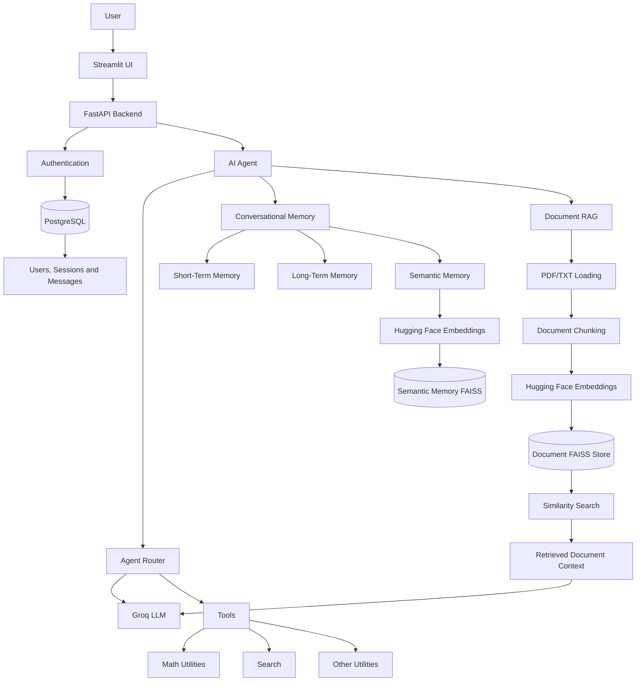

# GenAI Core — AI Agent Application

A personal project exploring a modular, LLM-powered conversational AI application with agent orchestration, tool execution, user authentication, PostgreSQL persistence, multi-layer conversational memory, and document-based Retrieval-Augmented Generation (RAG).

> **Project status:** Personal learning and development project. The implementation is evolving and is not intended to be a production-ready or security-audited service. See [Current Limitations and Future Improvements](#current-limitations-and-future-improvements).

## Overview

GenAI Core brings together:

* An LLM-powered conversational agent.
* Agent routing and tool execution.
* Configurable conversational personas.
* Short-term and long-term conversation memory.
* Semantic memory retrieval using embeddings and FAISS.
* Document-based RAG with PDF and TXT ingestion.
* Text extraction, document chunking, and embedding generation.
* FAISS-based document similarity search.
* Context-augmented LLM responses with document citations.
* A FastAPI backend and PostgreSQL data models for users, sessions, and messages.
* A Streamlit user interface.

The project explores how LLMs, retrieval systems, memory components, and backend services can work together to build a modular AI application.

## Architecture

The following diagram illustrates the application's high-level architecture and the relationship between conversational memory and document-based RAG.



**Architecture note:** Semantic memory and document RAG are separate capabilities. They can use the same embedding model and vector-search technology, but they serve different purposes. Semantic memory retrieves relevant conversational information, while document RAG retrieves information from ingested documents.

## Main Components

### 1. AI Agent and Orchestration

The `agent/` package contains the agent workflow and routing-related modules.

It coordinates language-model interactions and supports routing between conversational responses and tool execution.

The agent also coordinates conversational memory retrieval and document-based RAG.

Key files:

* `agent/agent.py` — Main agent implementation and execution workflows.
* `agent/router.py` — Agent routing logic.
* `agent/tool_chain.py` — Tool execution workflows.

### 2. Tool Integration

The `tools/` package contains utilities that the agent can invoke, including:

* Mathematical operations.
* Search functionality.
* General utility functions.

Available tools depend on the agent's routing logic and configuration.

### 3. Conversational Memory

The `memory/` package contains several approaches to retaining and retrieving conversational information.

| Component         | Purpose                                                                                          |
| ----------------- | ------------------------------------------------------------------------------------------------ |
| Short-term memory | Retains a limited window of recent conversation entries.                                         |
| Long-term memory  | Stores facts explicitly provided to be remembered.                                               |
| Semantic memory   | Uses text embeddings and FAISS similarity search to retrieve related conversational information. |

The semantic-memory implementation uses the `sentence-transformers/all-MiniLM-L6-v2` embedding model through Hugging Face integrations and LangChain's FAISS vector store.

### 4. Document Ingestion and Retrieval-Augmented Generation (RAG)

The application supports document-based Retrieval-Augmented Generation (RAG), allowing users to ask questions about previously ingested PDF and TXT documents.

The RAG workflow combines document processing, embedding generation, vector similarity search, and LLM-based answer generation.

#### Document ingestion workflow

1. **Document loading:** `PyPDFLoader` extracts text and metadata from PDF documents, while `TextLoader` handles TXT files.
2. **Document chunking:** `RecursiveCharacterTextSplitter` divides extracted text into smaller chunks.
3. **Embedding generation:** Hugging Face's `sentence-transformers/all-MiniLM-L6-v2` model converts document chunks into numerical embeddings.
4. **Vector indexing:** LangChain's FAISS integration indexes the document embeddings and maintains their associated text and metadata.
5. **Persistence:** The FAISS document index is saved locally so it can be loaded again when the application starts.

Current text-splitting configuration:

| Parameter     |            Value |
| ------------- | ---------------: |
| Chunk size    | 1,000 characters |
| Chunk overlap |   200 characters |

#### Document retrieval and answer generation

When a user submits a question through the regular Send operation:

1. **Query embedding:** The embedding model converts the user's question into a numerical vector.
2. **Similarity search:** FAISS searches the document vector index for relevant content.
3. **Chunk retrieval:** The application retrieves up to three relevant document chunks.
4. **Context construction:** Retrieved document text and metadata, including source filename and page number, are formatted into a context string.
5. **Prompt augmentation:** The retrieved context is included in the LLM prompt.
6. **Answer generation:** The Groq-hosted LLM generates an answer using the retrieved document information.
7. **Source citation:** The LLM is instructed to cite the source number, filename, and page number, and to avoid inventing unsupported information.

#### Example

Suppose an employee handbook has been ingested into the document store.

A user asks:

> How many vacation days do employees receive starting in their third year?

The application retrieves the relevant handbook content and generates an answer such as:

> Employees receive 20 vacation days annually starting in their third year, according to `employee_handbook.pdf`, Page 1. [Source 1]

The application also instructs the LLM to acknowledge when the retrieved documents do not contain sufficient information to answer a question.

#### RAG implementation files

* `memory/document_ingestion.py` — Document loading, text extraction, chunking, embedding generation, FAISS indexing, persistence, and similarity search.
* `agent/agent.py` — Document retrieval, context construction, prompt augmentation, and LLM answer generation.
* `server.py` — FastAPI endpoint that invokes the agent.

#### Current execution behavior

The application currently provides two different interaction paths:

| Operation        | Agent method     | Document RAG              |
| ---------------- | ---------------- | ------------------------- |
| Send             | `Agent.run()`    | Supported                 |
| Send (Streaming) | `Agent.stream()` | Not currently implemented |

The regular Send operation performs document retrieval and generates an answer using retrieved document context.

The Send (Streaming) operation provides general conversational responses with token-by-token output and does not currently perform document retrieval.

### 5. Authentication and Data Persistence

The application includes authentication logic and a PostgreSQL-backed data model.

The SQLAlchemy models define:

* **Users:** Account identity and a stored password-hash field.
* **Sessions:** Conversation sessions associated with users.
* **Messages:** User and assistant messages associated with sessions, including creation timestamps.

The database layer uses SQLAlchemy's asynchronous engine and session facilities.

Alembic is included for database schema migrations.

**Security note:** This is a personal project, not a security-audited authentication service. Before using it with real users or publishing it as production-ready, password storage, secret management, token handling, session authorization, and user-data isolation need to be reviewed and hardened.

### 6. Backend and Interface

The application uses FastAPI for backend services and Streamlit for the user interface.

Key files:

* `server.py` — FastAPI application/backend entry point.
* `ui.py` — Streamlit user interface.
* `db/` — Database setup and ORM models.
* `alembic/` — Database migration configuration and scripts.
* `auth.py` — Authentication-related functionality.

## Technology Stack

Technologies represented in the project include:

| Category                           | Technology                               |
| ---------------------------------- | ---------------------------------------- |
| Programming language               | Python                                   |
| LLM / Agent framework              | LangChain                                |
| LLM provider integration           | Groq                                     |
| Frontend                           | Streamlit                                |
| Backend                            | FastAPI                                  |
| Database                           | PostgreSQL                               |
| ORM / Asynchronous database access | SQLAlchemy                               |
| Database migrations                | Alembic                                  |
| Document loading                   | PyPDFLoader, TextLoader                  |
| Text splitting                     | RecursiveCharacterTextSplitter           |
| Embeddings                         | Hugging Face Sentence Transformers       |
| Embedding model                    | all-MiniLM-L6-v2                         |
| Vector store                       | FAISS                                    |
| Configuration                      | Environment variables with python-dotenv |

## Repository Structure

```text
genai-projects/
├── genai_core/
│   ├── agent/
│   │   ├── agent.py
│   │   ├── router.py
│   │   └── tool_chain.py
│   │
│   ├── alembic/
│   │   └── versions/
│   │
│   ├── db/
│   │   ├── database.py
│   │   └── models.py
│   │
│   ├── memory/
│   │   ├── document_ingestion.py
│   │   ├── memory.py
│   │   ├── multi_user_memory.py
│   │   └── semantic_memory.py
│   │
│   ├── models/
│   ├── tools/
│   ├── auth.py
│   ├── server.py
│   └── ui.py
│
├── .gitignore
└── README.md
```

## Local Setup

The following instructions provide a general setup outline. Confirm configuration names, dependencies, and startup commands against the current implementation.

### 1. Clone the repository

```bash
git clone https://github.com/haoshi999999999/genai-projects.git

cd genai-projects
```

### 2. Create and activate a virtual environment

**Windows PowerShell:**

```powershell
python -m venv .venv

.\.venv\Scripts\Activate.ps1
```

**macOS / Linux:**

```bash
python -m venv .venv

source .venv/bin/activate
```

### 3. Install dependencies

If `requirements.txt` is present:

```bash
pip install -r requirements.txt
```

If it has not yet been added, create and maintain one from the working environment before asking others to run the application.

Do not commit the virtual environment.

### 4. Configure environment variables

Create a local `.env` file and provide the configuration required by the application.

For example:

```dotenv
DATABASE_URL=postgresql+asyncpg://<username>:<password>@localhost:5432/<database_name>

GROQ_API_KEY=<your_groq_api_key>

SECRET_KEY=<a_long_random_secret>
```

These are illustrative variable names. Confirm the exact environment variable names used by the current code before running the application.

Important:

* Do not commit `.env`.
* Do not put API keys, database passwords, signing keys, or real user data in source files.
* Use `.env.example` to document required variable names with placeholder values only.

### 5. Prepare PostgreSQL and migrations

1. Install and start PostgreSQL.
2. Create the application database.
3. Configure the database connection string.
4. Apply the Alembic migrations using the project's migration configuration.

Confirm the exact migration command and working directory against the current `alembic.ini` and migration environment.

### 6. Configure the Groq API

Obtain a Groq API key and configure it in the local environment.

The application uses Groq-hosted LLM integration through LangChain.

Do not commit the API key to the repository.

### 7. Run the application

The backend entry point is `genai_core/server.py`.

Confirm the module/import setup and FastAPI application object name before choosing the Uvicorn command.

For example, if the application object is named `app` and the package is importable from the repository root:

```bash
uvicorn genai_core.server:app --reload
```

Start the Streamlit frontend using the appropriate command for the current project configuration.

For example, if running from the repository root:

```bash
streamlit run genai_core/ui.py
```

## Current Limitations and Future Improvements

This project is under active personal development. The following areas represent potential improvements.

### Document RAG

* Add duplicate-document detection to prevent repeated ingestion of identical documents.
* Introduce document-level metadata management, including document IDs, versioning, and ownership.
* Implement document deletion and re-indexing capabilities.
* Improve retrieval quality through configurable chunking and retrieval parameters.
* Add automated tests for document ingestion, similarity search, answer grounding, and citation accuracy.
* Improve document-level access control and user isolation before supporting multiple users with private documents.
* Explore retrieval evaluation and strategies for handling conflicting or outdated documents.

### Conversational Memory and Agent Architecture

* Improve memory persistence, concurrency handling, and lifecycle management.
* Add more comprehensive automated tests for agent routing, tool execution, and memory retrieval.
* Improve separation of concerns across agent orchestration, memory, and retrieval components.

### Authentication and Security

* Replace fast, unsalted SHA-256 password hashing with a dedicated password-hashing algorithm such as Argon2id or an appropriately configured PBKDF2 implementation.
* Load signing keys and service credentials from environment variables or a secrets manager.
* Use a maintained JWT library and enforce required claims, including token expiration.
* Enforce ownership checks so users can access only their own sessions and messages.
* Add user-level isolation to semantic memory retrieval. The current semantic-memory implementation should not be treated as safely isolated across users until this is implemented and tested.

### Testing and Operations

* Add automated tests for authentication, authorization, agent routing, memory retrieval, document ingestion, and API endpoints.
* Improve error handling and logging.
* Document and test the complete setup and execution workflow.
* Improve deployment configuration and operational monitoring.

## Disclaimer

This repository is a personal software development project intended for learning and demonstration.

It explores LLM-powered applications, agent orchestration, tool integration, conversational memory, and document-based RAG.

It is not presented as a production-ready or security-audited service. Do not deploy it with real user credentials or sensitive data without further security, privacy, reliability, and operational work.

## Author

Developed independently as a personal project exploring LLM-powered applications, agent workflows, backend engineering, conversational memory, and Retrieval-Augmented Generation.

GitHub: https://github.com/haoshi999999999
